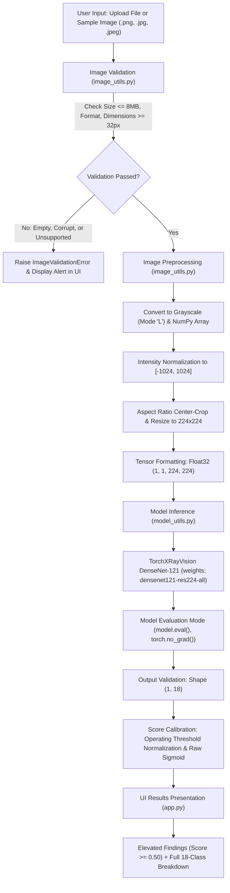

# System Architecture & Workflow — MediScan AI

MediScan AI is an educational computer vision web application designed to demonstrate the application of deep learning models to medical chest radiographs. The architecture enforces strict separation of concerns among user interface, image validation/preprocessing, and model inference.

---

## 1. End-to-End Pipeline Workflow

---

## 2. Component Responsibilities

### 2.1 `app.py` (User Interface & Presentation Layer)
- **Framework:** Streamlit (v1.66.1).
- **Theme:** Blue-and-white clinical research aesthetic with responsive cards, metrics, and data tables.
- **State Management & Caching:** Uses `@st.cache_resource` to cache model weights in memory, preventing redundant disk reads or initialization overhead during multi-step user interactions.
- **Workflow Orchestration:** Coordinates user actions (upload, sample selection, analysis trigger, reset).
- **Transparency & Education:** Prominently displays the non-clinical educational disclaimer, pathology definitions, operating point criteria, and technical preprocessing logs.

### 2.2 `image_utils.py` (Image Validation & Preprocessing)
- **In-Memory File Validation:**
  - Enforces a maximum file size threshold (8 MB).
  - Validates allowed extensions (`.png`, `.jpg`, `.jpeg`) and decoded internal formats (`PNG`, `JPEG`).
  - Guards against zero-byte files, truncated payloads, and corrupted bytes using `Image.open().load()`.
  - Enforces dimension bounds (minimum $32 \times 32$ px, maximum $8192 \times 8192$ px).
- **Radiographic Preprocessing Pipeline:**
  - Converts arbitrary RGB/RGBA/Grayscale inputs to single-channel 8-bit intensity (`L` mode).
  - Applies TorchXRayVision standard intensity scaling:
    $$\text{normalized}(x) = \left(\frac{x}{255}\right) \times 2048 - 1024$$
    mapping pixel values from $[0, 255]$ to the standard dynamic range $[-1024, 1024]$.
  - Preserves anatomical aspect ratio through `xrv.datasets.XRayCenterCrop()`.
  - Bilinearly interpolates to $224 \times 224$ pixels via `xrv.datasets.XRayResizer(224)`.
  - Assembles and returns a 4D PyTorch FloatTensor of shape `(1, 1, 224, 224)`.

### 2.3 `model_utils.py` (Model Inference & Postprocessing)
- **Model Architecture:** DenseNet-121 with an 18-class linear classification head.
- **Weight Provenance:** Pretrained weights (`densenet121-res224-all`, 28.38 MB) trained across 6 benchmark chest X-ray datasets.
- **Inference Discipline:**
  - Sets `model.eval()` to freeze BatchNorm running statistics and disable Dropout.
  - Enforces `torch.no_grad()` to prevent computation graph construction and memory leakage.
  - Validates tensor input shape `(batch, 1, 224, 224)` prior to forward pass.
  - Validates tensor output shape `(batch, 18)` following the forward pass.
- **Operating-Point Calibration:**
  - Computes both raw sigmoid probabilities $\sigma(z) \in [0, 1]$ and dataset-calibrated operating scores using piecewise linear mapping centered at 0.50:
    $$\text{score} = \begin{cases} \frac{\sigma(z)}{2 \cdot \theta} & \text{if } \sigma(z) < \theta \\ 1.0 - \frac{1.0 - \sigma(z)}{2 \cdot (1 - \theta)} & \text{if } \sigma(z) \ge \theta \end{cases}$$
    where $\theta$ is the empirical operating threshold for each pathology.
  - Associates each pathology with plain-English anatomical explanations.

### 2.4 `tests/` (Automated Test Suite)
- **`test_image_utils.py`:** Tests PNG/JPEG decoding, invalid extensions, corrupted files, empty files, oversized payloads, sub-minimum dimensions, preprocessing output shapes, and value ranges.
- **`test_model_utils.py`:** Tests input tensor shapes, non-tensor rejection, channel mismatch, spatial resolution mismatch, mock inference end-to-end, error handling, and a smoke test using real pretrained weights.
